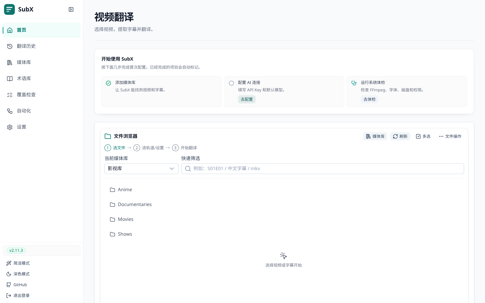
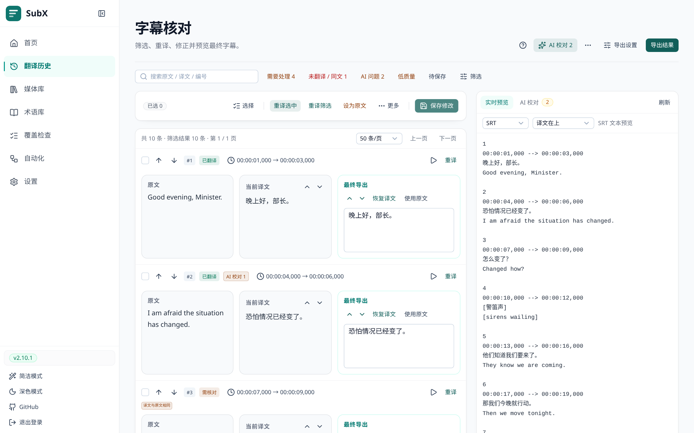
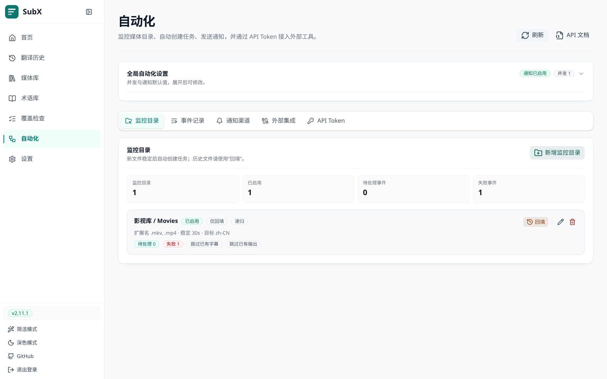
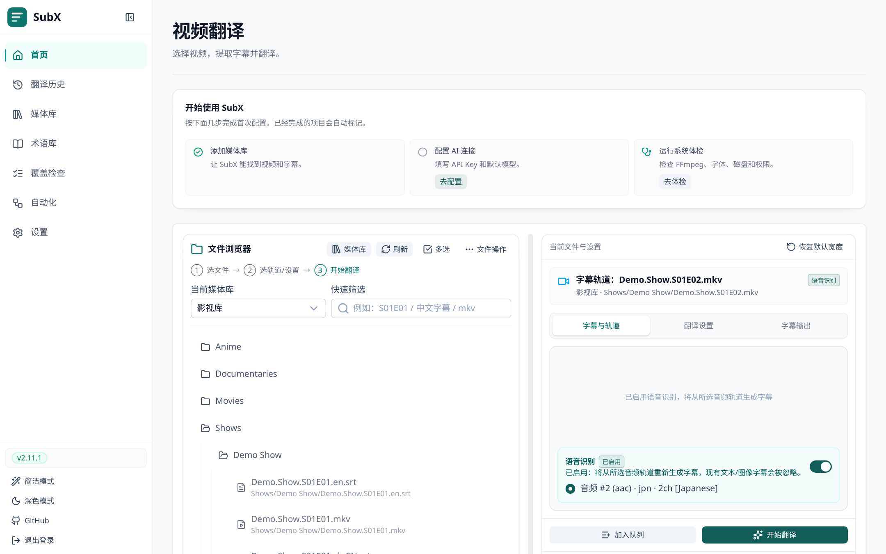

# SubX

> 把 NAS 里的生肉视频，变成能直接看的双语字幕。

[](https://github.com/MaroD1M/subx/releases)
[](LICENSE)
[](https://github.com/MaroD1M/subx/pkgs/container/subx)

当前版本：**v2.10.0** · [文档索引](docs/README.md) · [使用文档](docs/usage.md) · [部署文档](docs/deployment.md) · [更新日志](CHANGELOG.md)

SubX 是面向 NAS 与自托管环境的 AI 字幕工作台。它会扫描媒体库，读取内嵌/外挂字幕，或通过语音识别与图像字幕 OCR 生成文本，再调用 LLM 翻译，最终输出可核对的 SRT/ASS。API Key、字幕、媒体和模型都可以留在自己的机器上。

## 目录

- [适合谁](#适合谁)
- [界面预览](#界面预览)
- [核心能力](#核心能力)
- [快速开始](#快速开始)
- [按场景选读](#按场景选读)
- [文档导航](#文档导航)
- [数据与安全](#数据与安全)
- [技术栈](#技术栈)
- [本地开发](#本地开发)
- [许可证与致谢](#许可证与致谢)

## 适合谁

- NAS 里存了一堆剧集，却懒得逐部找字幕。
- 想让翻译保留人物语气、剧情上下文和专有名词。
- 希望 API Key、字幕和媒体文件都留在自己机器上。
- 想接 Ollama，把翻译成本压到接近零。

## 界面预览

| 首页工作台 | 字幕核对 |
| --- | --- |
|  |  |

| 自动化 | 语音识别来源 |
| --- | --- |
|  |  |

> 预览图由 `npm run preview:images` 使用稳定演示数据统一生成，实际界面会随版本继续优化。

## 核心能力

- **找片**：多媒体库、目录树、内嵌轨道探测、外挂 SRT/ASS/SSA/VTT。
- **翻译**：上下文分块、术语表、自定义风格、片名/背景、翻译记忆、简繁双输出、缓存、重试和备用供应商回退。
- **质量**：双模型评分、技术质检（行长/CPS/时长/重叠）、问题标签、AI 校对与术语学习。
- **语音识别**：内置 faster-whisper / Silero VAD，可选 whisper.cpp 和云 ASR 兜底；有字幕也可强制重听。
- **图像字幕**：内置 Tesseract / RapidOCR，处理 PGS / VobSub / DVD，长片支持 PGS 直通和分段断点。
- **核对导出**：三栏编辑、批量重译、时间轴调整、实时预览，输出单语/双语 SRT/ASS。
- **自动化**：目录监控、覆盖检查、历史回填、规则过滤、通知、API Token 和调用审计。
- **外部集成**：Sonarr、Radarr、Jellyfin、Plex、Emby、Bazarr Webhook 和路径映射。
- **本地优先**：OpenAI 兼容、Anthropic、Gemini 协议，也可接 Ollama / LM Studio / llama.cpp / vLLM。

## 快速开始

前置要求：Docker 与 Compose v2，x86_64 或 arm64，建议至少 4GB 内存和 2–3GB 镜像空间；模型目录另预留 10–20GB。

把下面内容放进 `docker-compose.yml`，改一行媒体路径：

```yaml
services:
  subx:
    image: ghcr.io/marod1m/subx:v2.10.0
    container_name: subx
    restart: unless-stopped
    ports:
      - "3000:3000"
    environment:
      TZ: Asia/Shanghai
      VIDEO_DIR: /media
      DB_PATH: /app/db/subx.db
      PUID: 1001
      PGID: 1001
      SUBX_ALL_IN_ONE: "true"
      ASR_AUTO_DOWNLOAD: "false"
      # 建议设置：至少 32 位随机字符串
      # SUBX_SECRET_KEY: change-me
    volumes:
      - /path/to/your/media:/media
      - ./data/db:/app/db
      - ./data/temp:/app/temp
      - ./data/backups:/app/backups
      - ./data/models:/models
    healthcheck:
      test: ["CMD-SHELL", "curl -fsS http://127.0.0.1:3000/api/health >/dev/null || exit 1"]
      interval: 30s
      timeout: 5s
      retries: 5
      start_period: 60s
```

启动：

```bash
docker compose up -d
```

访问 `http://NAS_IP:3000`，第一次进入先设置至少 8 位访问口令。

首次打开后：

1. 进入「媒体库」添加容器内路径，例如 `/media`，并执行路径检测。
2. 打开「设置 → 语音识别 → 本地模型管理」，手动下载 Whisper 模型。
3. 需要图像字幕时，在「设置 → 图像字幕 OCR」开启 OCR。
4. 回首页选择视频或字幕文件，选风格、模型和输出设置，开始翻译。
5. 在「翻译历史」查看进度，完成后进入「字幕核对」精修。

> 完整参数、NAS 路径、反向代理和拆分部署见 [部署文档](docs/deployment.md)；环境变量见 [环境变量参考](docs/reference/environment.md)。

## 按场景选读

| 场景 | 文档 |
| --- | --- |
| 接 Ollama 或局域网模型 | [翻译设置](docs/guide/translation.md) |
| 无字幕视频听写 | [媒体库与语音识别](docs/guide/media-asr.md) |
| PGS / VobSub / DVD 图像字幕 | [图像字幕 OCR](docs/guide/ocr.md) |
| 新片自动翻译、通知和 Webhook | [自动化与集成](docs/guide/automation.md) |
| 校对、改时间轴、导出 ASS | [核对与导出](docs/guide/review-export.md) |
| 清理缓存、备份和健康检查 | [运维与数据管理](docs/operations.md) |
| 升级或回滚 | [升级与回滚](docs/reference/upgrade.md) |
| 报错排查 | [故障排查](docs/troubleshooting.md) |

## 文档导航

- [文档索引](docs/README.md)：按角色和场景组织的完整入口。
- [快速开始](docs/getting-started.md)：首次配置、媒体库和第一个任务。
- [使用文档](docs/usage.md)：所有使用者文档的入口。
- [部署文档](docs/deployment.md)：Compose、NAS、反向代理和拆分部署。
- [更新日志](CHANGELOG.md)：版本变更、迁移和升级注意事项。
- [维护与架构](docs/development/maintenance.md)：目录职责、数据库迁移和发版流程。
- [实测指南](docs/development/testing-guide.md)：真实设备与功能回归清单。

## 数据与安全

- 首次初始化完成前，只开放登录/初始化相关接口。
- 口令使用 `scrypt` 加盐哈希；Session Token 只存哈希。
- API Key 使用 AES-256-GCM 加密存储；更换 `SUBX_SECRET_KEY` 后旧 Key 需要重填。
- 文件操作统一做 realpath 校验，默认跳过符号链接。
- 删除任务和清空历史使用事务；导出前自动备份同名旧字幕。
- 媒体、字幕、模型和数据库都保存在自己挂载的目录中。

## 技术栈

- **前端**：Nuxt 4 + Vue 3 + Nuxt UI + Tailwind CSS
- **服务端**：Nitro
- **数据库**：SQLite（`better-sqlite3`，WAL），可选 PostgreSQL
- **媒体处理**：FFmpeg / ffprobe
- **语音识别**：内置 faster-whisper / Silero VAD，可选 whisper.cpp、GPU sidecar
- **OCR**：内置 Tesseract / RapidOCR
- **AI**：OpenAI 兼容、Anthropic 原生、Gemini 原生
- **测试**：Vitest + Playwright + axe-core
- **部署**：Docker / docker-compose / GitHub Actions

## 本地开发

环境要求：Node.js 22.22.3+、FFmpeg / FFprobe。

```bash
npm install
npm run dev
```

质量检查：

```bash
npm run lint
npm run typecheck
npm test
npm run test:ocr
npm run docs:check
npm run build
```

开发环境示例：

```env
VIDEO_DIR=/absolute/path/to/media
DB_PATH=./db/subx.db
FFMPEG_PATH=/usr/bin/ffmpeg
FFPROBE_PATH=/usr/bin/ffprobe
```

贡献方式见 [CONTRIBUTING.md](CONTRIBUTING.md)，安全问题见 [SECURITY.md](SECURITY.md)。

## 许可证与致谢

本项目基于 [chao-eng/subx](https://github.com/chao-eng/subx) 开发，原项目已停止维护，核心能力与设计思路归功于原作者。

- 项目地址：<https://github.com/MaroD1M/subx>
- 问题反馈：<https://github.com/MaroD1M/subx/issues>
- 许可证：AGPL-3.0，详见 [LICENSE](LICENSE) 与 [NOTICE.md](NOTICE.md)

Copyright (c) 2026 MaroD1M。上游 [chao-eng/subx](https://github.com/chao-eng/subx) 采用 MIT License，本项目的修改与扩展以 AGPL-3.0 发布。分发衍生作品或通过网络向用户提供服务时，必须按 AGPL-3.0 的要求提供完整对应源码。
