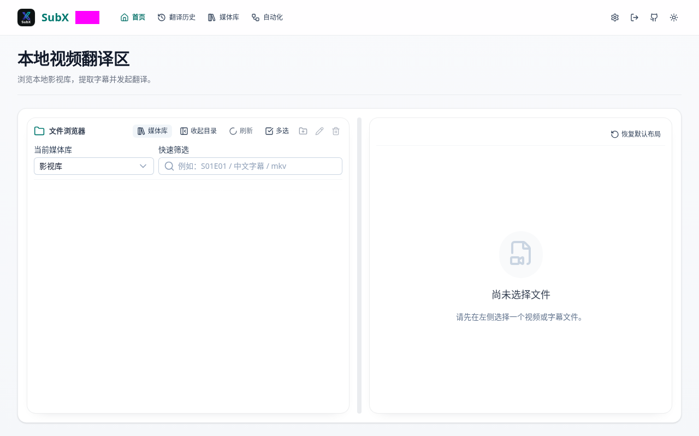
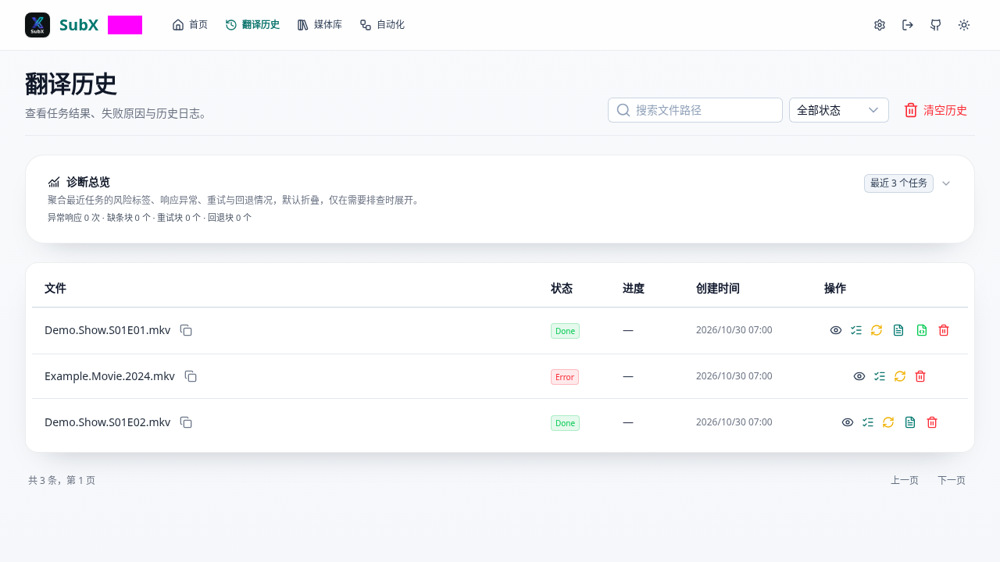
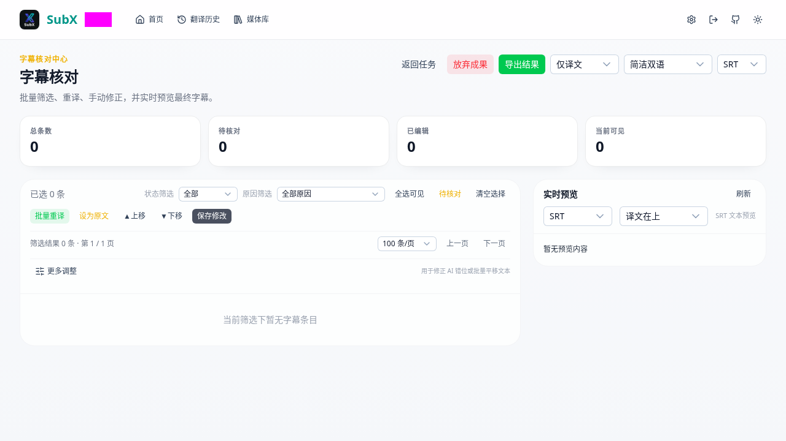
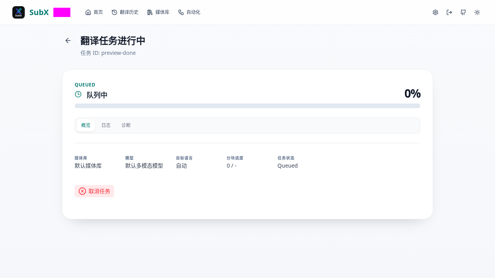
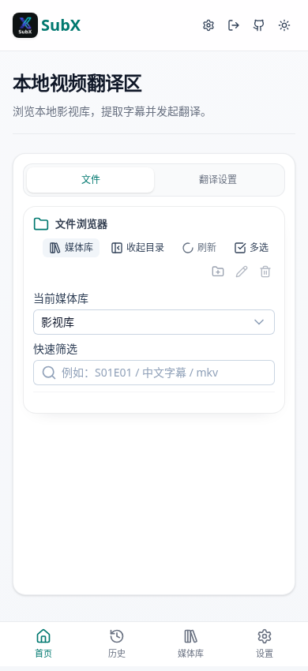
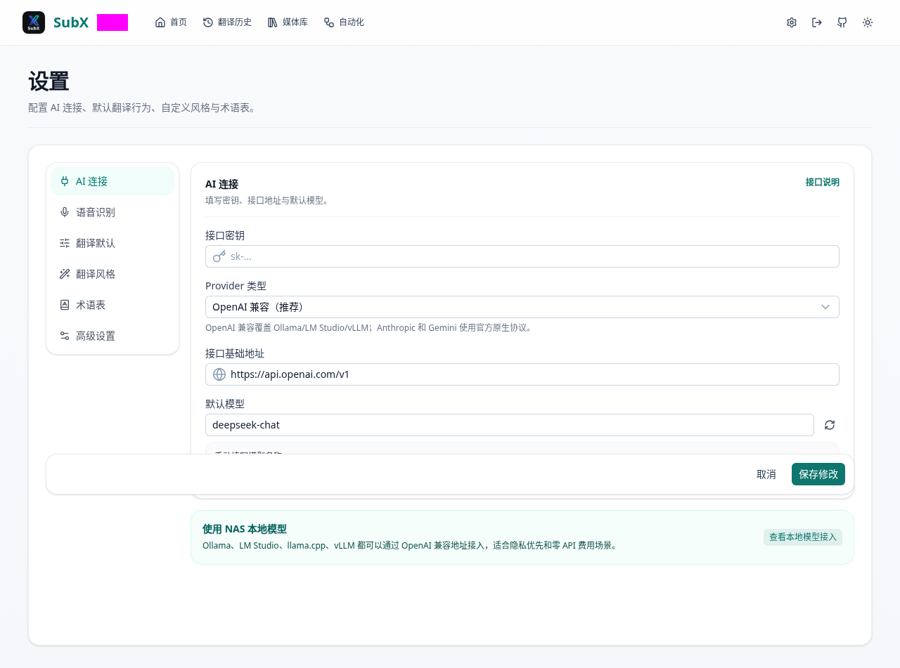

# SubX

> 把 NAS 里的生肉视频，变成能直接看的双语字幕。

当前版本：**v2.6.1** · [使用文档](docs/usage.md) · [部署文档](docs/deployment.md) · [更新日志](CHANGELOG.md)

[项目地址](https://github.com/MaroD1M/subx) · [问题反馈](https://github.com/MaroD1M/subx/issues)

> 本仓库基于 [chao-eng/subx](https://github.com/chao-eng/subx) 开发而来。原项目已停止维护，本项目在其基础上继续维护和增强，核心能力与设计思路归功于原作者。

---

## v2.6.1 新东西

- **登录页不再“点了没反应”**：「获取帮助」现在会打开内置帮助弹窗，忘记口令、HTTPS、文档和反馈入口都在里面。
- **口令规则终于说人话**：统一 8 位，前端提示、后端校验和文档不再三方打架。
- **登录/退出不再犯迷糊**：已登录访问 `/login` 自动回首页；退出接口失败也不会卡在“看起来还登录着”。
- **Telegram 通知修好了**：改用 undici fetch，渠道代理和环境变量代理都能生效，支持 NO_PROXY，报错会告诉你真实原因。
- **ASR 更抗折腾**：服务没就绪会等、识别失败会重试、旧地址不可达会尝试内置地址，错误里直接写试过哪些地址。
- **文档排障更直接**：新增「忘记口令」、Telegram/通知代理排障和 ASR 服务排查步骤。

## v2.6.0 新东西

- **有字幕也能重新听写**：视频已有文本字幕时，右侧「语音识别」卡片可选；打开开关就忽略现有字幕，改用音频重新识别。
- **ASR 设置真正生效**：「运行设备」和「计算精度」现在会随请求传给 ASR 服务，不再只是改 UI。
- **配置不会自己“变回去”**：单镜像旧 sidecar 地址只迁移一次；之后你保存的 ASR/OCR 地址不会被反复覆盖。
- **保存后立即生效**：设置页保存后会清掉 Nuxt 配置缓存，返回首页就能看到新的 ASR/OCR 开关状态。
- **Compose 和环境变量说人话**：每个变量、端口、卷、健康检查、资源限制和 profile 都有中文注释；部署文档按主镜像 / ASR / OCR / 数据库 / 高级参数分组。
- **文档减负**：README、部署、使用、ASR/OCR README 统一补齐，少绕弯子，直接告诉你该改哪一行。

## v2.5.0 新东西

- **单镜像开箱即用**：主应用、ASR、OCR 合并进 `ghcr.io/marod1m/subx`，默认只需一个容器。
- **模型不再静默下载**：Whisper 模型不打包进镜像，进入设置页手动开始下载。
- **完整下载管理**：显示进度、速度、剩余时间，支持暂停、续传、取消、重试和卸载。
- **下载代理与镜像站**：模型下载支持 HTTP(S) 代理和 `ASR_HF_ENDPOINT` 镜像站。
- **镜像拉取体验**：新增 `scripts/pull-image.sh`，显示 Docker 原生进度，Ctrl+C 暂停后可续传，并支持代理提示。
- **OCR 零下载**：Tesseract 语言包和 RapidOCR 已内置，启用后即可处理 PGS/VobSub/DVD。
- **拆分部署仍可选**：独立 ASR/OCR sidecar、增强版和 GPU 版继续保留，供扩容或特殊硬件使用。

---

## 界面预览

| 首页工作台 | 翻译历史 |
| --- | --- |
|  |  |

| 字幕核对 | 任务详情 |
| --- | --- |
|  |  |

| 移动端首页 | 设置与自定义风格 |
| --- | --- |
|  |  |

> 预览图基于演示数据生成，实际界面会随版本继续优化。

---

## 它适合谁

- NAS 里存了一堆剧集，却懒得逐部找字幕。
- 想让翻译保留人物语气、剧情上下文和专有名词。
- 希望 API Key、字幕和媒体文件都留在自己机器上。
- 想接 Ollama，把翻译成本压到接近零。

---

## 30 秒跑起来

把下面这段放进 `docker-compose.yml`，改一行媒体路径：

```yaml
services:
  subx:
    image: ghcr.io/marod1m/subx:v2.6.1
    container_name: subx
    restart: unless-stopped
    ports:
      - "3000:3000"
    environment:
      TZ: Asia/Shanghai
      VIDEO_DIR: /media
      DB_PATH: /app/db/subx.db
      PUID: 1001
      PGID: 1001
      SUBX_ALL_IN_ONE: "true"
      ASR_AUTO_DOWNLOAD: "false"
    volumes:
      - /path/to/your/media:/media
      - ./data/db:/app/db
      - ./data/temp:/app/temp
      - ./data/models:/models
```

启动：

```bash
docker compose up -d
```

访问 `http://NAS_IP:3000`，第一次进入先设置至少 8 位访问口令。

> 单镜像实测（v2.6.1，不含模型）：amd64 下载约 **586 MiB**，解压后约 **1.57 GiB**（磁盘约 1.6–1.8 GB）；arm64 下载约 **520 MiB**。也可以先执行 `./scripts/pull-image.sh`，按 Ctrl+C 暂停后重新运行即可续传。
>
> 根目录 [`docker-compose.yml`](docker-compose.yml) 已逐项注释端口、卷、环境变量、健康检查、资源限制和 profiles；完整变量表见 [部署文档第 4 节](docs/deployment.md#4-环境变量与参数)。

### 第一次打开做什么

1. 设置访问口令并登录。
2. 进入「媒体库」添加容器内路径，例如 `/media`。
3. 执行路径检测，确认挂载和权限正常。
4. 打开「设置 → 语音识别」，在「本地模型管理」里手动下载 Whisper 模型。
5. 开启「启用语音识别」；有字幕的视频也可以在选择文件后打开「语音识别」开关，强制重新听写。
6. 需要图像字幕时开启「图像字幕 OCR」。
6. 回首页选视频或字幕文件，选风格、模型和输出设置，开始翻译。
7. 去「翻译历史」看进度，完成后可进入「字幕核对」精修。

> ASR 默认地址是内置服务 `http://127.0.0.1:8000`，OCR 是 `http://127.0.0.1:8001`。拆分部署时可改成 sidecar 服务名。

---

## 功能一览

| 区域 | 能做什么 |
| --- | --- |
| **找片** | 多媒体库、目录树、内嵌轨道探测、外挂 SRT/ASS/SSA/VTT |
| **翻译** | 上下文分块、术语表、自定义风格、片名/背景、缓存、重试、回退 |
| **核对** | 筛选、批量重译、三栏编辑、调序、分页、实时预览 |
| **自动化** | 目录监控、历史回填、规则过滤、通知、API Token、调用审计 |
| **多引擎** | 内置 faster-whisper、whisper.cpp、OpenAI 兼容云 ASR 兜底；有字幕也可强制语音识别 |
| **OCR** | 内置 Tesseract / RapidOCR，处理 PGS / VobSub / DVD 图像字幕 |
| **模型管理** | 下载进度、速度、剩余时间、暂停、续传、取消、重试、卸载、代理 |
| **质量** | 双模型评分、问题标签、低分核对、质量报告、AI 校对与术语学习 |
| **集成** | Sonarr/Radarr/Jellyfin/Plex/Emby/Bazarr Webhook、路径映射 |
| **运维** | 持久队列、任务日志、Token 统计、诊断总览、健康检查、轻量指标、多 Worker |

### 字幕工作台

- 多套媒体库，支持默认库、排序、启用/停用和路径检测。
- 目录树懒加载、展开状态记忆、路径复制。
- 文件多选和批量加入翻译队列。
- 桌面分栏，移动端「文件 / 翻译设置」切换。

### AI 翻译

- 兼容 OpenAI 协议，也支持 Anthropic、Gemini 原生协议。
- 纯 Token 估算分块，带前文上下文，取消即时中止。
- 内置翻译风格，也能自定义 Prompt。
- 任务级片名、剧情背景、人物关系和额外要求。
- 术语表、翻译缓存、非语言字幕跳过、自动重试与回退。

### 核对与导出

- 自动标记缺译、同源、串条、译文过长等问题。
- 按状态/原因筛选，批量重译，手动编辑和调序。
- 原文、当前译文、最终导出三栏编辑。
- 单语 / 双语 / 仅原文，SRT / ASS / 两者同时输出。
- 原始 ASS 时间轴和样式尽量保留。

---

## NAS 本地模型

SubX 支持通过 OpenAI 兼容接口接入本地模型，适合隐私优先和零 API 费用场景。

| 服务 | 示例地址 | 备注 |
| --- | --- | --- |
| Ollama | `http://NAS_IP:11434/v1` | 推荐设置 `OLLAMA_HOST=0.0.0.0` |
| LM Studio | `http://NAS_IP:1234/v1` | 需启动 Local Server |
| llama.cpp | `http://NAS_IP:8080/v1` | 以实际监听端口为准 |
| vLLM | `http://NAS_IP:8000/v1` | 适合 GPU / 并发场景 |

> [!TIP]
> Docker 里不要写 `localhost`，它指向 SubX 容器自己。请用 NAS 局域网 IP、容器服务名或 `host.docker.internal`。
>
> 模型列表拿不到时，在设置页打开「手动填写模型名称」即可。

---

## 无字幕视频 / 本地 ASR

单镜像已经内置 ASR，不需要额外启动 sidecar。首次使用只需下载模型：

1. 进入「设置 → 语音识别」。
2. 在「本地模型管理」选择模型并点击「下载」。
3. 页面会显示下载进度、速度、剩余时间；可随时暂停、继续、取消或重试。
4. 下载完成后开启「启用语音识别」，ASR 地址保持 `http://127.0.0.1:8000`。

选中视频后，右侧会显示「语音识别」卡片：

- 视频没有文本字幕时，默认走 ASR。
- 视频已有文本字幕时，默认仍用字幕；想重新听写、修正错字或处理字幕质量差的片源，打开开关即可强制走 ASR。
- 开启 ASR 后，当前选中的文本/图像字幕轨道会被忽略，任务改用所选音频轨道重新识别。

模型默认保存到 `./data/models`，不会打包进镜像。下载支持：

- HTTP(S) 代理：页面填写，或设置 `ASR_DOWNLOAD_PROXY`。
- Hugging Face 镜像站：设置 `ASR_HF_ENDPOINT`，例如 `https://hf-mirror.com`。
- 断点续传：中断后重新开始会复用 `.part` 文件。

首页选择无文本字幕的视频时，会出现「语音识别」音轨选择；开始任务后会依次执行：

```text
提取音频 → VAD → faster-whisper 识别 → 生成字幕 → 翻译 → 核对 → 导出
```

> [!TIP]
> 低配 NAS 选 `small + int8`；16GB 以上可尝试 `medium`；Apple Silicon / ARM 可切换 `whisper-cpp`。
>
> 需要 GPU 时使用独立 `asr-gpu` sidecar：`docker compose --profile asr-gpu up -d asr-gpu`，设置页地址改为 `http://subx-asr-gpu:8000`。
>
> 需要拆分部署时仍可使用独立 CPU sidecar：`docker compose --profile asr up -d asr`，地址改为 `http://subx-asr:8000`。
>
> 独立 ASR 镜像：`ghcr.io/marod1m/subx-asr:v2.6.1`；可选鉴权：设置 `ASR_API_KEY` 后在设置页填写相同 Key。

---

## 自动化与 API

进入「自动化」页面可以配置：

- **监控目录**：新建独立子目录，或在「媒体库」卡片上直接开启整库监控。
- **规则**：递归、扩展名、包含/排除正则、体积、视频时长、创建/修改时间、稳定等待、已有字幕/输出跳过。
- **输出策略**：目标语言、输出模式、字幕格式、翻译风格、模型和通知渠道。
- **历史回填**：手动指定时间范围，按全局自动并发逐步处理，不默认全库扫描。
- **事件记录**：查看去重结果、失败原因，并手动重试。
- **通知渠道**：Telegram、邮件 SMTP、Webhook、ntfy、Discord、Matrix、企业微信；密钥加密保存，支持测试发送。
- **API Token**：按任务/自动化/Token/系统权限拆分 scope，可设置过期时间并随时撤销。
- **外部集成**：Sonarr、Radarr、Jellyfin、Plex、Emby、Bazarr Webhook，支持下载器路径到媒体库路径映射。
- **规则模板**：电影库、剧集库、动画、低配 NAS、双语字幕一键套用。

OpenAPI 文档：

```text
GET /api/openapi.json
```

调用示例：

```bash
curl -H "Authorization: Bearer subx_xxx" \
  "http://NAS_IP:3000/api/tasks?page=1&pageSize=20"
```

> [!TIP]
> Token 明文只在创建时显示一次。API 调用审计可在「自动化 → API Token」底部查看。
>
> 自动任务默认并发 1，可在自动化页调整，避免和手动任务争抢 CPU/GPU。

---

## 权限与常见坑

> [!IMPORTANT]
> `SQLITE_CANTOPEN` 多半不是数据库坏了，而是 `/app/db` 对容器用户不可写。

- 镜像会按 `PUID/PGID` 自动修复 `DB_PATH` 所在目录、`/app/temp` 和 `/models` 权限。
- 默认用户是 `1001:1001`。媒体文件属于其他用户时，把 `PUID/PGID` 改成实际所有者。
- 媒体目录默认不做递归 chown，避免大目录启动缓慢；需要时设置 `CHOWN_MEDIA=true`。
- 从旧 sidecar 切换到单镜像后，如果模型目录属主异常，可临时设置 `CHOWN_MODELS=true`。
- 页面里的媒体库路径必须填**容器内路径**，不是宿主机路径。
- 反向代理记得透传 `X-Forwarded-Proto`；需要时再开启 `TRUST_PROXY=true`。
- 更换 `SUBX_SECRET_KEY` 后，旧 API Key 无法解密，需要重新填写。

---

## 升级到 v2.6.1

```bash
docker compose pull
docker compose up -d --force-recreate
```

升级说明：

- v2.6.1 单镜像继续包含主应用、ASR 和 OCR；旧的 `--profile asr` / `--profile ocr` 不再需要。
- 新镜像启动时会等 ASR/OCR 健康检查通过，低配机器首次启动可能多等 10–30 秒，这是正常的。
- Telegram/通知代理已改用 undici fetch；如果渠道里填了 `127.0.0.1`，请改成宿主机局域网 IP。
- 登录口令统一为至少 8 位；已有口令不受影响，只有新建实例和修改提示生效。
- 新增 `./data/models:/models` 卷；模型需要在设置页手动下载，或复用旧的模型缓存。
- 旧的 `http://subx-asr:8000` / `http://subx-ocr:8000` 地址会一次性迁移到 `127.0.0.1`；迁移后以设置页保存的地址为准。如需继续连接外部 sidecar，设置 `SUBX_KEEP_LEGACY_SIDECAR_URLS=true`。
- 主应用、ASR、OCR 镜像建议同步升级到 v2.6.1。
- 未设置 `DATABASE_URL` 时继续使用 SQLite。
- PostgreSQL 同步桥仍是低并发方案；生产高并发建议等待异步 DB 层。
- 旧 Session 会失效，需要重新登录。
- 建议升级前备份 `./data/db`、`./data/models` 与 PostgreSQL 数据库。

---

## 安全说明

- 首次初始化完成前，只开放登录/初始化相关接口。
- 口令使用 `scrypt` 加盐哈希。
- API Key 使用 AES-256-GCM 加密存储。
- Session Token 只存哈希。
- 文件操作统一做 realpath 校验，默认跳过符号链接。
- 运行中任务需要先取消，才能删除记录。

---

## 技术栈

- **前端**：Nuxt 4 + Vue 3 + Nuxt UI + Tailwind CSS
- **服务端**：Nitro
- **数据库**：SQLite（`better-sqlite3`，WAL）
- **媒体处理**：FFmpeg / ffprobe
- **语音识别**：内置 faster-whisper / Silero VAD，可选 whisper.cpp、GPU sidecar
- **OCR**：内置 Tesseract / RapidOCR
- **字幕处理**：`ass-compiler`、`srt-parser-2`，内置 VTT 解析与编码检测
- **AI**：OpenAI 兼容、Anthropic 原生、Gemini 原生
- **实时进度**：SSE
- **测试**：Vitest + Playwright + axe-core
- **部署**：Docker / docker-compose / GitHub Actions

---

## 本地开发

环境要求：Node.js 18+、FFmpeg / FFprobe。

```bash
npm install
npm run dev
```

质量检查：

```bash
npm run lint
npm run typecheck
npm test
npm run build
```

端到端视觉与可访问性检查：

```bash
npx playwright install chromium
npm run test:e2e
```

开发环境示例：

```env
VIDEO_DIR=/absolute/path/to/media
DB_PATH=./db/subx.db
FFMPEG_PATH=/usr/bin/ffmpeg
FFPROBE_PATH=/usr/bin/ffprobe
```

---

## 文档与致谢

- [使用文档](docs/usage.md)：翻译设置、模型下载、自定义风格、核对页、字幕格式、日志排查。
- [部署文档](docs/deployment.md)：单镜像、模型下载、镜像拉取、NAS、反向代理、升级备份、常见问题。
- [更新日志](CHANGELOG.md)：版本变更和升级注意事项。
- [ASR 自动化技术方案](docs/asr-automation-plan.md)：无字幕视频、语音识别、目录监控与通知规划。
- [技术交接文档](docs/PROJECT_HANDOVER.md)：架构、已完成、未完成、路线图、维护约定。
- [ASR 11 语言基准](docs/asr-benchmark.md)：基准脚本、样本规范与报告模板。
- [PostgreSQL 迁移评估](docs/postgresql-evaluation.md)：PG 运行时、同步桥限制与数据迁移。
- [实测指南](docs/testing-guide.md)：单镜像模型下载、真实 NAS、OCR、PG 和多 Worker 回归清单。
- [开发 TODO](TODO.md)：分阶段任务清单和验收标准。

本项目基于 [chao-eng/subx](https://github.com/chao-eng/subx) 开发，原项目已停止维护。

- 项目地址：<https://github.com/MaroD1M/subx>
- 问题反馈：<https://github.com/MaroD1M/subx/issues>
- 许可证：MIT，详见 [LICENSE](LICENSE)
