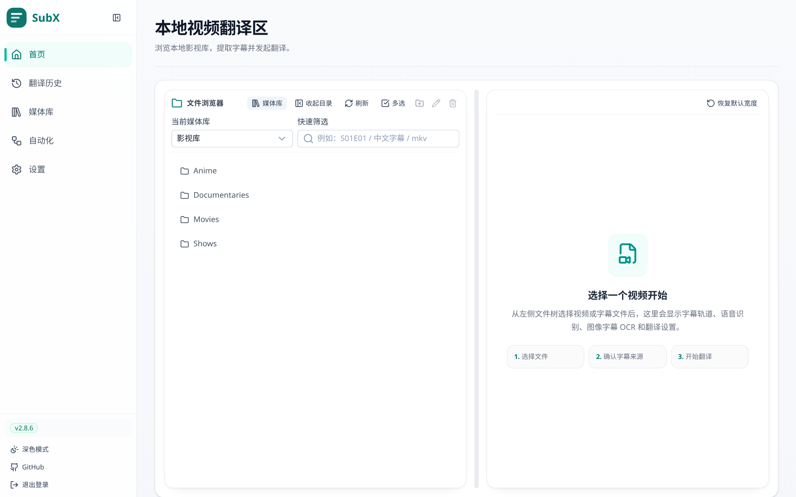
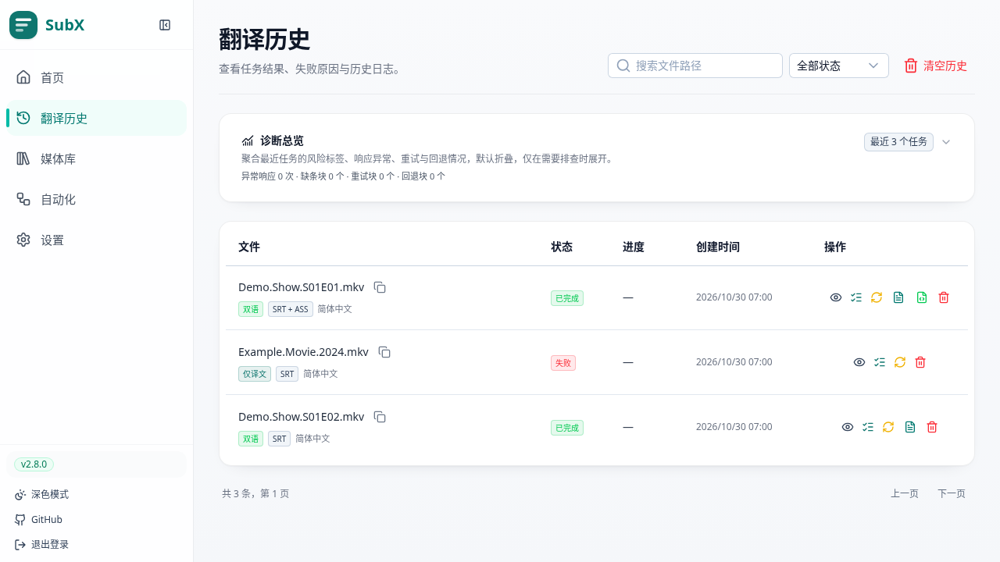
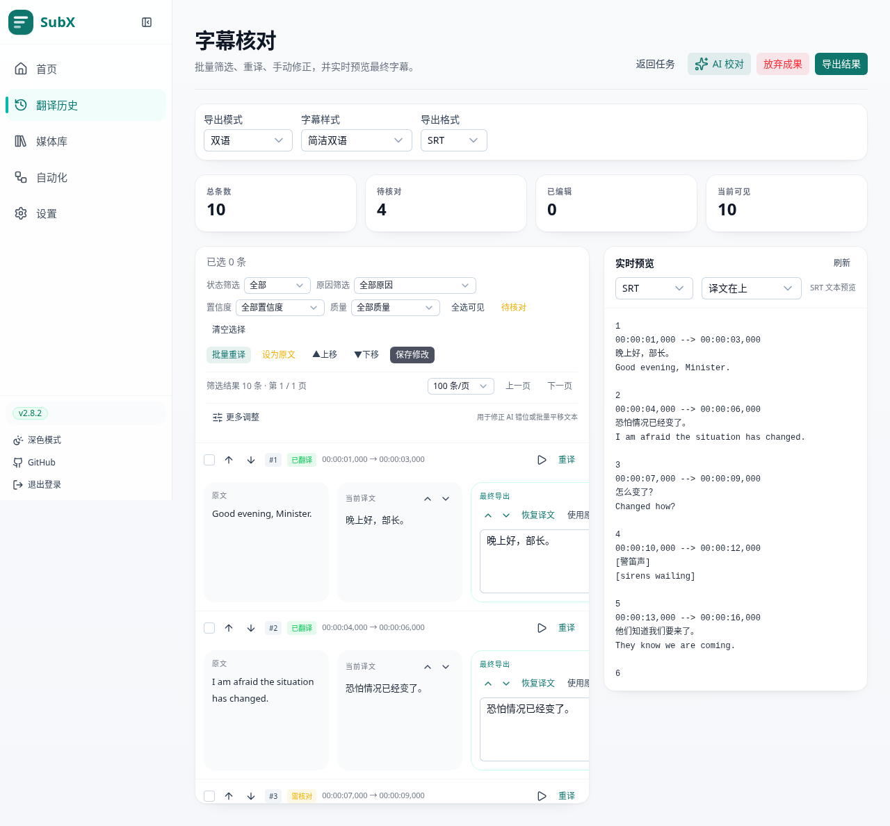
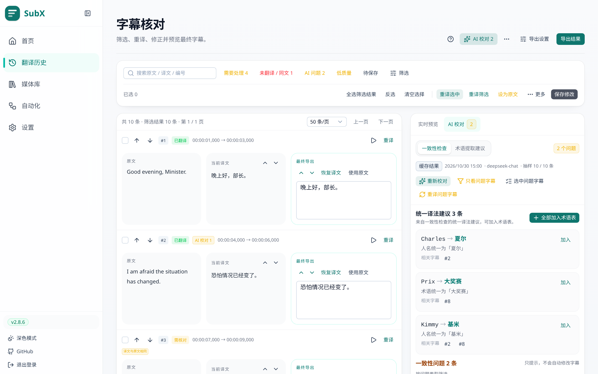
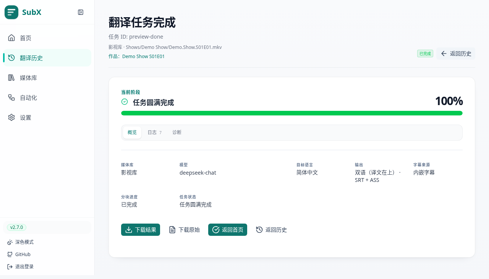
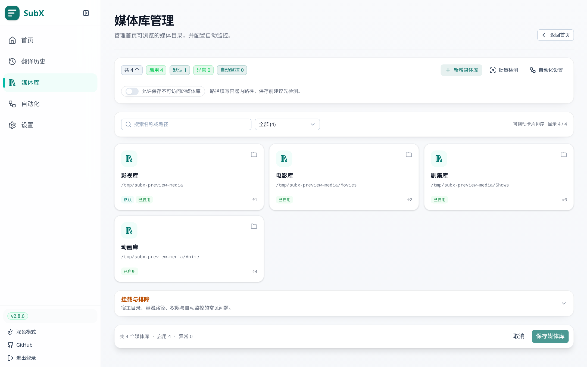
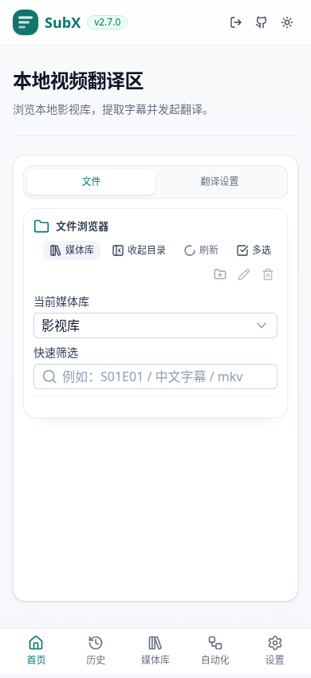
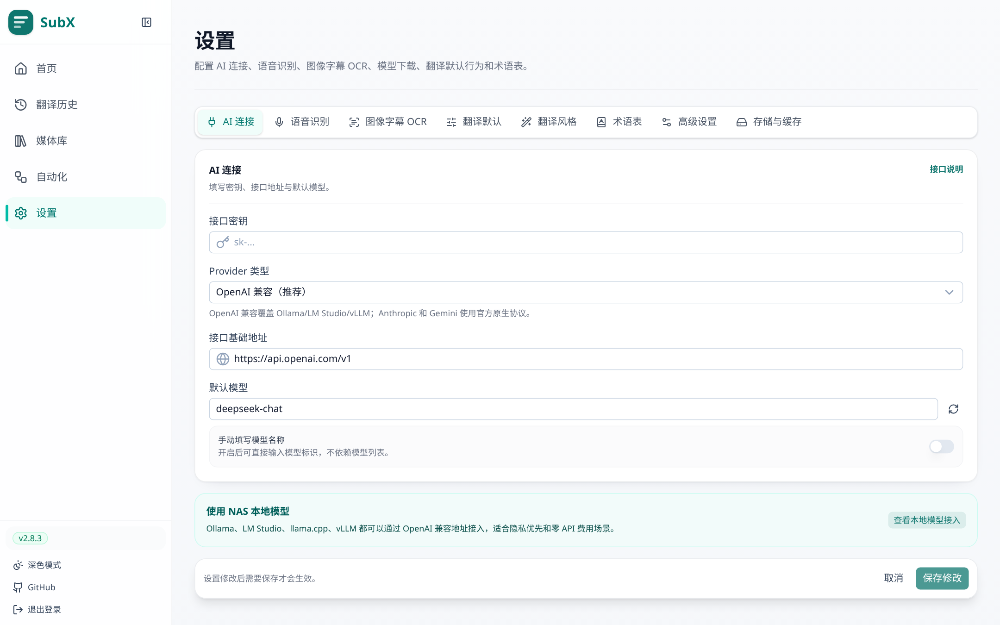
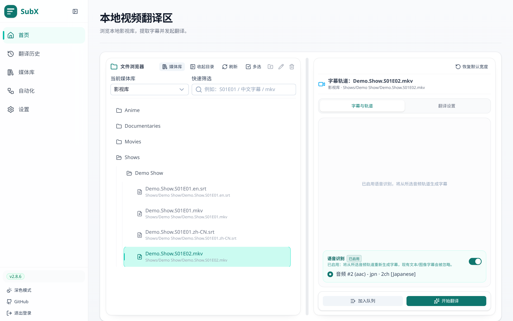
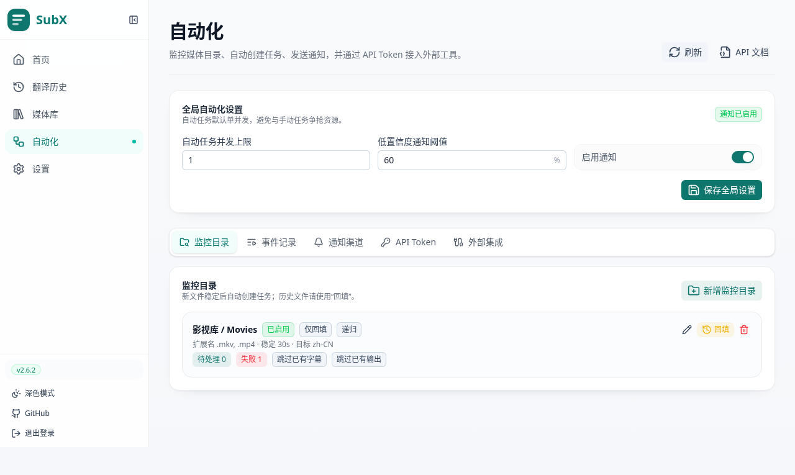

# SubX

> 把 NAS 里的生肉视频，变成能直接看的双语字幕。

当前版本：**v2.9.1** · [使用文档](docs/usage.md) · [部署文档](docs/deployment.md) · [维护说明](docs/maintenance.md) · [更新日志](CHANGELOG.md)

[项目地址](https://github.com/MaroD1M/subx) · [问题反馈](https://github.com/MaroD1M/subx/issues)

> 本仓库基于 [chao-eng/subx](https://github.com/chao-eng/subx) 开发而来。原项目已停止维护，本项目在其基础上继续维护和增强，核心能力与设计思路归功于原作者。

---

## ✨ 近期亮点

- 🛠️ **v2.9.1 稳定性更新**：修复本地 ASR 在 undici 8 下创建任务失败；ASR/OCR 检测显示实际配置；新增轮询重试、模型 sha256 校验、历史模型后台校验和模型缓存上限。
- 🏠 **家庭 NAS 友好**：新增简洁模式、低功耗 NAS 预设、系列记忆、覆盖检查和备用供应商回退。
- 🔤 **字体与实景预览**：字体选择器可搜索并显示服务器安装状态；可从视频抽帧并按完整分辨率烧录当前 ASS 样式，便于核对字号、颜色和位置。
- 💾 **数据安全**：任务删除和清空历史改为事务执行；导出前自动备份同名旧字幕；任务失败日志不再输出 API Key 前缀和上游响应体。
- 🎬 **长电影 OCR 不再被 2 小时限制误拦**：默认上限提升到 4 小时，并可在应用设置页调整。
- 🧩 **PGS 长片直通**：PGS 优先走 pgsrip，不再强制整片抽帧；失败时自动回退到分段图像 OCR。
- 💾 **VobSub / DVD 自动分段**：长视频按 30 分钟一段处理，每段完成立即清理帧文件。
- 🔁 **断点续跑**：失败重试会复用已完成分段，断点默认保留 24 小时，避免整片重新 OCR。
- ⚙️ **长视频参数进设置页**：最大时长、分段、PGS/抽帧超时、重试、断点、无进度超时和总任务上限都可配置。
- 🧾 **错误提示更准确**：OCR 超时不再误报“供应商服务异常”，任务详情直接提示调大上限或改用语音识别。

> v2.7.0 的目录批量选择、同集去重、批量轨道策略、通知详情继续保留。
>
> 更早版本的变化见 [CHANGELOG.md](CHANGELOG.md)。

---

## 🖼️ 界面预览

| 首页工作台 | 翻译历史 |
| --- | --- |
|  |  |

| 字幕核对 | AI 校对与问题筛选 |
| --- | --- |
|  |  |

| 任务详情 | 媒体库管理 |
| --- | --- |
|  |  |

| 移动端首页 | 设置与自定义风格 |
| --- | --- |
|  |  |

| 语音识别来源 | 自动化 |
| --- | --- |
|  |  |

> 预览图由 `npm run preview:images` 使用稳定演示数据统一生成（1440×900 视口），实际界面会随版本继续优化。

---

## 👤 它适合谁

- NAS 里存了一堆剧集，却懒得逐部找字幕。
- 想让翻译保留人物语气、剧情上下文和专有名词。
- 希望 API Key、字幕和媒体文件都留在自己机器上。
- 想接 Ollama，把翻译成本压到接近零。

---

## 🚀 30 秒跑起来

把下面这段放进 `docker-compose.yml`，改一行媒体路径：

```yaml
services:
  subx:
    image: ghcr.io/marod1m/subx:v2.9.1
    container_name: subx
    restart: unless-stopped
    ports:
      - "3000:3000"
    environment:
      TZ: Asia/Shanghai
      VIDEO_DIR: /media
      DB_PATH: /app/db/subx.db
      PUID: 1001
      PGID: 1001
      SUBX_ALL_IN_ONE: "true"
      ASR_AUTO_DOWNLOAD: "false"
    volumes:
      - /path/to/your/media:/media
      - ./data/db:/app/db
      - ./data/temp:/app/temp
      - ./data/backups:/app/backups
      - ./data/models:/models
```

启动：

```bash
docker compose up -d
```

访问 `http://NAS_IP:3000`，第一次进入先设置至少 8 位访问口令。

> 镜像体积会随版本、架构和内置字体变化，建议至少预留 2–3 GB 磁盘；也可以先执行 `./scripts/pull-image.sh`，按 Ctrl+C 暂停后重新运行即可续传。
>
> 根目录 [`docker-compose.yml`](docker-compose.yml) 已逐项注释端口、卷、环境变量、健康检查、资源限制和 profiles；完整变量表见 [部署文档第 4 节](docs/deployment.md#4-环境变量与参数)。

### 第一次打开做什么

1. 设置访问口令并登录。
2. 进入「媒体库」添加容器内路径，例如 `/media`。
3. 执行路径检测，确认挂载和权限正常。
4. 打开「设置 → 语音识别」，在「本地模型管理」里手动下载 Whisper 模型。
5. 开启「启用语音识别」；有字幕的视频也可以在选择文件后打开「语音识别」开关，强制重新听写。
6. 需要图像字幕时进入「设置 → 图像字幕 OCR」开启 OCR，可按需选择 OCR 语言和引擎。
7. 在「设置 → 存储与缓存」查看磁盘占用，并按类型清理 ASR 音频、OCR 临时图像、任务日志等缓存。
8. 回首页选视频或字幕文件，选风格、模型和输出设置，开始翻译。
9. 去「翻译历史」看进度，完成后可进入「字幕核对」精修。

> ASR 默认地址是内置服务 `http://127.0.0.1:8000`，OCR 是 `http://127.0.0.1:8001`。拆分部署时可改成 sidecar 服务名。

---

## 🧩 功能一览

| 区域 | 能做什么 |
| --- | --- |
| **找片** | 多媒体库、目录树、内嵌轨道探测、外挂 SRT/ASS/SSA/VTT |
| **翻译** | 上下文分块、术语表、自定义风格、片名/背景、缓存、重试、回退 |
| **核对** | 筛选、批量重译、三栏编辑、调序、分页、实时预览 |
| **自动化** | 目录监控、历史回填、规则过滤、通知、API Token、调用审计 |
| **多引擎** | 内置 faster-whisper、whisper.cpp、OpenAI 兼容云 ASR 兜底；有字幕也可强制语音识别 |
| **OCR** | 内置 Tesseract / RapidOCR，处理 PGS / VobSub / DVD；长电影支持 PGS 直通和分段断点 |
| **模型管理** | 下载进度、速度、剩余时间、暂停、续传、取消、重试、卸载、代理 |
| **质量** | 双模型评分、问题标签、低分核对、质量报告、AI 校对与术语学习 |
| **集成** | Sonarr/Radarr/Jellyfin/Plex/Emby/Bazarr Webhook、路径映射 |
| **运维** | 持久队列、任务日志、Token 统计、诊断总览、健康检查、轻量指标、多 Worker |

### 字幕工作台

- 多套媒体库，支持默认库、排序、启用/停用和路径检测。
- 覆盖检查：按媒体库扫描缺失、待核对、处理中、失败和已完成字幕，支持按系列筛选和批量补齐。
- 系列记忆：自动按剧集保存标题、背景、摘要和术语表，后续集数自动复用。
- 目录树懒加载、展开状态记忆、路径复制。
- 文件/目录多选、递归扫描、同集版本去重和批量轨道策略。
- 桌面分栏，移动端「文件 / 翻译设置」切换。

### AI 翻译

- 兼容 OpenAI 协议，也支持 Anthropic、Gemini 原生协议。
- 支持备用供应商回退：主供应商失败时可用本地 Ollama 或低价模型补译。
- 纯 Token 估算分块，跨块带前 6 条 + 后 6 条语境，取消即时中止。
- 21 种内置翻译风格，覆盖犯罪、谍战、科幻、动画、家庭、医疗、武侠、恐怖、纪录片、脱口秀等常见影视类型，也能自定义 Prompt。
- 字幕输出独立设置：SRT/ASS、双语布局、预设样式，以及原文/译文分别设置字体、字号、颜色、描边和阴影。
- 可搜索字体选择器，支持推荐字体、服务器已安装字体和手动输入；实景预览可抽取视频画面并按完整分辨率烧录字幕样式。
- 任务级片名、剧情背景、人物关系和额外要求。
- 术语表、翻译缓存、非语言字幕跳过、自动重试与回退。

### 核对与导出

- 自动标记缺译、同源、串条、译文过长等问题。
- 按状态/原因筛选，批量重译，手动编辑和调序。
- 原文、当前译文、最终导出三栏编辑。
- 单语 / 双语 / 仅原文，SRT / ASS / 两者同时输出。
- 原始 ASS 时间轴和样式尽量保留。

---

## 🧠 NAS 本地模型

SubX 支持通过 OpenAI 兼容接口接入本地模型，适合隐私优先和零 API 费用场景。

| 服务 | 示例地址 | 备注 |
| --- | --- | --- |
| Ollama | `http://NAS_IP:11434/v1` | 推荐设置 `OLLAMA_HOST=0.0.0.0` |
| LM Studio | `http://NAS_IP:1234/v1` | 需启动 Local Server |
| llama.cpp | `http://NAS_IP:8080/v1` | 以实际监听端口为准 |
| vLLM | `http://NAS_IP:8000/v1` | 适合 GPU / 并发场景 |

> [!TIP]
> Docker 里不要写 `localhost`，它指向 SubX 容器自己。请用 NAS 局域网 IP、容器服务名或 `host.docker.internal`。
>
> 模型列表拿不到时，在设置页打开「手动填写模型名称」即可。

---

## 🎙️ 无字幕视频 / 本地 ASR

单镜像已经内置 ASR，不需要额外启动 sidecar。首次使用只需下载模型：

1. 进入「设置 → 语音识别」。
2. 在「本地模型管理」选择模型并点击「下载」。
3. 页面会显示下载进度、速度、剩余时间；可随时暂停、继续、取消或重试。
4. 下载完成后开启「启用语音识别」，ASR 地址保持 `http://127.0.0.1:8000`。

选中视频后，右侧会显示「语音识别」卡片：

- 视频没有文本字幕时，默认走 ASR。
- 视频已有文本字幕时，默认仍用字幕；想重新听写、修正错字或处理字幕质量差的片源，打开开关即可强制走 ASR。
- 开启 ASR 后，当前选中的文本/图像字幕轨道会被忽略，任务改用所选音频轨道重新识别。
- 关闭 ASR 后，「语音识别」卡片和视频选择会保留；如果没有文本/图像字幕轨，开始按钮会禁用并提示原因。

ASR 提取的音频会缓存到 `./data/temp/asr-audio`（容器内 `/app/temp/asr-audio`），默认保留 14 天。成功任务默认删除音频，失败或取消的任务会保留缓存，重试时直接复用；可用 `ASR_AUDIO_CACHE_DAYS` 调整保留天数，开启「保留临时音频」则成功任务也不删除。

模型默认保存到 `./data/models`，不会打包进镜像。下载支持：

- HTTP(S) 代理：页面填写，或设置 `ASR_DOWNLOAD_PROXY`。
- Hugging Face 镜像站：设置 `ASR_HF_ENDPOINT`，例如 `https://hf-mirror.com`。
- 断点续传：中断后重新开始会复用 `.part` 文件。

首页选择无文本字幕的视频时，会出现「语音识别」音轨选择；开始任务后会依次执行：

```text
提取音频 → VAD → faster-whisper 识别 → 生成字幕 → 翻译 → 核对 → 导出
```

> [!TIP]
> 低配 NAS 选 `small + int8`；16GB 以上可尝试 `medium`；Apple Silicon / ARM 可切换 `whisper-cpp`。
>
> 需要 GPU 时使用独立 `asr-gpu` sidecar：`docker compose --profile asr-gpu up -d asr-gpu`，设置页地址改为 `http://subx-asr-gpu:8000`。
>
> 需要拆分部署时仍可使用独立 CPU sidecar：`docker compose --profile asr up -d asr`，地址改为 `http://subx-asr:8000`。
>
> 独立 ASR 镜像：`ghcr.io/marod1m/subx-asr:v2.9.1`；可选鉴权：设置 `ASR_API_KEY` 后在设置页填写相同 Key。

---

## 🤖 自动化与 API

进入「自动化」页面可以配置：

- **监控目录**：新建独立子目录，或在「媒体库」右侧编辑器直接开启整库监控。
- **规则**：递归、扩展名、包含/排除正则、体积、视频时长、创建/修改时间、稳定等待、已有字幕/输出跳过。
- **输出策略**：目标语言、输出模式、字幕格式、翻译风格、模型和通知渠道。
- **历史回填**：手动指定时间范围，按全局自动并发逐步处理，不默认全库扫描。
- **事件记录**：查看去重结果、失败原因，并手动重试。
- **通知渠道**：Telegram、邮件 SMTP、Webhook、ntfy、Discord、Matrix、企业微信；密钥加密保存，支持测试发送。
- **API Token**：按任务/自动化/Token/系统权限拆分 scope，可设置过期时间并随时撤销。
- **外部集成**：Sonarr、Radarr、Jellyfin、Plex、Emby、Bazarr Webhook，支持下载器路径到媒体库路径映射。
- **规则模板**：电影库、剧集库、动画、低配 NAS、双语字幕一键套用。

OpenAPI 文档：

```text
GET /api/openapi.json
```

调用示例：

```bash
curl -H "Authorization: Bearer subx_xxx" \
  "http://NAS_IP:3000/api/tasks?page=1&pageSize=20"
```

> [!TIP]
> Token 明文只在创建时显示一次。API 调用审计可在「自动化 → API Token」底部查看。
>
> 自动任务默认并发 1，可在自动化页调整，避免和手动任务争抢 CPU/GPU。

---

## 🔐 权限与常见坑

> [!IMPORTANT]
> `SQLITE_CANTOPEN` 多半不是数据库坏了，而是 `/app/db` 对容器用户不可写。

- 镜像会按 `PUID/PGID` 自动修复 `DB_PATH` 所在目录、`/app/temp` 和 `/models` 权限。
- 默认用户是 `1001:1001`。媒体文件属于其他用户时，把 `PUID/PGID` 改成实际所有者。
- 媒体目录默认不做递归 chown，避免大目录启动缓慢；需要时设置 `CHOWN_MEDIA=true`。
- 从旧 sidecar 切换到单镜像后，如果模型目录属主异常，可临时设置 `CHOWN_MODELS=true`。
- 页面里的媒体库路径必须填**容器内路径**，不是宿主机路径。
- 反向代理记得透传 `X-Forwarded-Proto`；需要时再开启 `TRUST_PROXY=true`。
- 更换 `SUBX_SECRET_KEY` 后，旧 API Key 无法解密，需要重新填写。

---

## ⬆️ 升级到 v2.9.1

```bash
docker compose pull
docker compose up -d --force-recreate
```

本版包含稳定性修复和家庭 NAS 体验更新；从 v2.9.0 升级会自动执行数据库迁移 v10（新增系列记忆表），从 v2.8.6 及更早版本升级会依次执行 v9 / v10。

升级说明：

- 修复本地 ASR 在 undici 8 下创建任务失败（`UND_ERR_INVALID_ARG`）。
- ASR/OCR 检测现在显示设置页实际选择的模型、引擎、设备和语言。
- ASR/OCR 状态轮询遇到瞬时网络错误会自动重试；OCR 排队任务不再被无进度超时误取消。
- 模型下载增加 Hugging Face sha256 校验；启动时后台校验历史模型文件，损坏模型会标记为未安装。
- 模型缓存默认按内存自适应（`<16GB` 保留 1 个，`>=16GB` 保留 2 个），切换模型不再无限占用内存。
- 修复 whisper.cpp 引擎下载路由、旧目录名冲突和旧暂停任务迁移；模型目录名冲突会自动加短哈希。
- 新增系列记忆、覆盖检查、简洁模式、低功耗 NAS 预设、备用供应商回退和核对页时间编辑。
- 拆分部署时请同步升级主应用、ASR 和 OCR 镜像到 v2.9.1。
- 建议升级前执行备份。

---

## 🛡️ 安全说明

- 首次初始化完成前，只开放登录/初始化相关接口。
- 口令使用 `scrypt` 加盐哈希。
- API Key 使用 AES-256-GCM 加密存储。
- Session Token 只存哈希。
- 文件操作统一做 realpath 校验，默认跳过符号链接。
- 运行中任务需要先取消，才能删除记录。

---

## 🛠️ 技术栈

- **前端**：Nuxt 4 + Vue 3 + Nuxt UI + Tailwind CSS
- **服务端**：Nitro
- **数据库**：SQLite（`better-sqlite3`，WAL）
- **媒体处理**：FFmpeg / ffprobe
- **语音识别**：内置 faster-whisper / Silero VAD，可选 whisper.cpp、GPU sidecar
- **OCR**：内置 Tesseract / RapidOCR
- **字幕处理**：`ass-compiler`、`srt-parser-2`，内置 VTT 解析与编码检测
- **AI**：OpenAI 兼容、Anthropic 原生、Gemini 原生
- **实时进度**：SSE
- **测试**：Vitest + Playwright + axe-core
- **部署**：Docker / docker-compose / GitHub Actions

---

## 💻 本地开发

环境要求：Node.js 22.22.3+、FFmpeg / FFprobe。

```bash
npm install
npm run dev
```

质量检查：

```bash
npm run lint
npm run typecheck
npm test
npm run test:ocr
npm run build
```

端到端视觉与可访问性检查：

```bash
npx playwright install chromium
npm run test:e2e
```

开发环境示例：

```env
VIDEO_DIR=/absolute/path/to/media
DB_PATH=./db/subx.db
FFMPEG_PATH=/usr/bin/ffmpeg
FFPROBE_PATH=/usr/bin/ffprobe
```

---

## 📚 文档与致谢

- [使用文档](docs/usage.md)：批量选择、轨道策略、翻译设置、模型下载、核对页、字幕格式和日志排查。
- [部署文档](docs/deployment.md)：单镜像、模型下载、镜像拉取、NAS、反向代理、升级备份和常见问题。
- [更新日志](CHANGELOG.md)：版本变更和升级注意事项。
- [ASR 11 语言基准](docs/asr-benchmark.md)：基准脚本、样本规范与报告模板。
- [PostgreSQL 运行时与迁移](docs/postgresql-evaluation.md)：PG 运行时、同步桥限制与数据迁移。
- [实测指南](docs/testing-guide.md)：单镜像模型下载、真实 NAS、OCR、PG 和多 Worker 回归清单。

本项目基于 [chao-eng/subx](https://github.com/chao-eng/subx) 开发，原项目已停止维护。

- 项目地址：<https://github.com/MaroD1M/subx>
- 问题反馈：<https://github.com/MaroD1M/subx/issues>
- 许可证：MIT，详见 [LICENSE](LICENSE)
